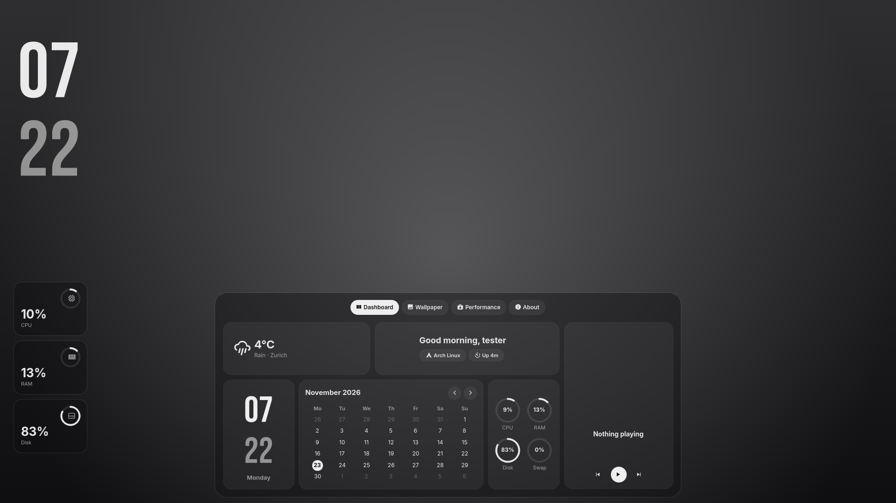
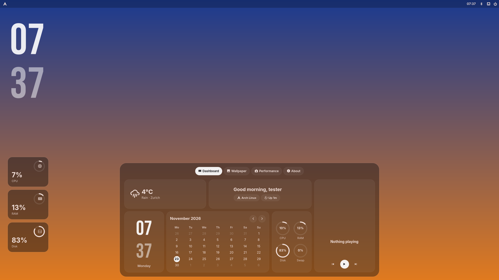

# hypr-shell

Eigenes Hyprland-Setup im Glas-Look, angelehnt an „DarkShadow's Shell“:
halbtransparente Flächen über unscharfem Hintergrund, stark gerundete Ecken und
Farben, die automatisch aus dem Hintergrundbild entstehen. Gedacht für Arch-basierte
Systeme (CachyOS) mit Hyprland ab 0.55 (Lua-Konfiguration) und Quickshell.



## Installation

```bash
gh repo clone Louidos/hypr-shell && cd hypr-shell && ./install.sh
```

Danach **abmelden und im Login-Manager „Hyprland“ wählen**. Das ist alles.

Der Installer

- installiert die nötigen Pakete (pacman, den Rest mit paru) und prüft die Namen vorher,
- kopiert die Dateien nach `~/.config`, `~/.local/bin`, `~/.local/share` und `~/Pictures/Wallpapers`,
- sichert **jede** ersetzte Datei vorher nach `~/.config/hypr-shell-backup-<Zeit>/`,
- übernimmt das Tastaturlayout aus `localectl` und Umgebungsvariablen der alten
  Hyprland-Konfiguration (z. B. für NVIDIA), damit Spiele wie vorher starten,
- läuft nie als root; sudo wird nur für pacman verwendet,
- listet am Ende auf, falls noch ein Programm fehlt.

| Option | Wirkung |
| --- | --- |
| `--yes` | keine Rückfrage |
| `--dry-run` | nur anzeigen, was passieren würde – nichts wird verändert |
| `--no-packages` | keine Pakete installieren, nur Dateien kopieren |
| `--restore [ORDNER]` | Stand vor der letzten Installation zurückholen |
| `--uninstall` | alles von hypr-shell entfernen, Zustand vor der ersten Installation zurück |

## Rückgängig machen

```bash
./install.sh --restore
```

holt die Dateien zurück, die die letzte Installation ersetzt hat, und entfernt die neu
hinzugekommenen. Mit `./install.sh --restore ~/.config/hypr-shell-backup-<Zeit>` lässt sich
eine bestimmte Sicherung wählen.

```bash
./install.sh --uninstall
```

entfernt alle Dateien von hypr-shell und stellt den Zustand vor der ersten Installation
her. Die Sicherungsordner bleiben liegen. Danach abmelden und wieder anmelden.

## Tastenkürzel

| Kürzel | Wirkung |
| --- | --- |
| `SUPER + Q` | Terminal (kitty) |
| `SUPER + C` | Fenster schliessen |
| `SUPER + E` | Dateien (Nautilus) |
| `SUPER + R` / `ALT + Space` | Starter (rofi) |
| `SUPER + V` | Fenster schwebend / gekachelt |
| `SUPER + M` | abmelden (Hyprland beenden) |
| `SUPER + L` | sperren |
| `SUPER + left` / `SUPER + right` / `SUPER + up` / `SUPER + down` | Fokus in diese Richtung |
| `SUPER + 1` … `SUPER + 0` | zu Arbeitsfläche 1–10 |
| `SUPER + SHIFT + 1` … `SUPER + SHIFT + 0` | Fenster auf Arbeitsfläche 1–10 verschieben |
| `SUPER + mouse_down` / `SUPER + mouse_up` (Mausrad) | nächste / vorige Arbeitsfläche |
| `SUPER + mouse:272` (linke Maustaste ziehen) | Fenster verschieben |
| `SUPER + mouse:273` (rechte Maustaste ziehen) | Fenstergrösse ändern |
| `SUPER + ALT + D` | Dashboard öffnen / schliessen |
| `SUPER + W` | Dashboard im Tab Wallpaper |
| `SUPER + A` | Hot-Corner-Panel öffnen / schliessen |
| `Print` | Screenshot eines Bereichs (speichern + Zwischenablage) |
| `SHIFT + Print` | Screenshot des ganzen Bildschirms (speichern + Zwischenablage) |
| `XF86AudioRaiseVolume` / `XF86AudioLowerVolume` | Lautstärke + / − |
| `XF86AudioMute` / `XF86AudioMicMute` | Ton / Mikrofon stumm |
| `XF86MonBrightnessUp` / `XF86MonBrightnessDown` | Helligkeit + / − |
| `XF86AudioPlay` / `XF86AudioPause` / `XF86AudioNext` / `XF86AudioPrev` | Medien: Play/Pause, weiter, zurück |
| `Esc` | Dashboard oder Panel schliessen |
| Wischen mit drei Fingern | Arbeitsfläche wechseln |

Maus: Ecke **unten rechts** öffnet das Panel, die **Mitte der unteren Kante** das Dashboard.

## Was ist dabei?

### Leiste

Oben eine flache, halbtransparente Waybar: links Distro-Symbol (öffnet den Starter),
Arbeitsflächen 1–4 und das aktuelle Lied; rechts Lautstärke, Uhr, Bluetooth, WLAN, ein
roter Punkt während einer Bildschirmaufnahme und der Ausschalt-Knopf (sperren, abmelden,
neu starten, herunterfahren).

### Desktop

Hinter den Fenstern eine grosse gestapelte Uhr (JetBrainsMono, Stunden kräftig, Minuten
blasser) und drei Glas-Kacheln mit Ringen für CPU, Arbeitsspeicher und Grafikkarte. Schläft
die NVIDIA-Karte (Hybrid-Grafik), zeigt die GPU-Kachel „–“ – sie wird dafür nicht geweckt.


### Dashboard

Gleitet unten in der Mitte hoch. Oben vier gleich breite Tabs (Symbol über dem Text, der
aktive als weisse Pille):

| Tab | Inhalt |
| --- | --- |
| Dashboard | Wetter, Profil mit Begrüssung, Musik, Uhr, Kalender, drei Ringe für CPU/RAM/Disk |
| Wallpaper | alle Bilder aus `~/Pictures/Wallpapers` mit Suche; Klick setzt Bild und Farben |
| Performance | CPU und GPU mit Modell, Temperatur und Auslastung („Usage“; eine schlafende NVIDIA-Karte wird nicht geweckt), Datenträger, Netzwerk mit Verlauf, Arbeitsspeicher |
| About | System, Distribution, Version von hypr-shell, Hyprland und Quickshell |

Systemwerte werden nur abgefragt, solange das Dashboard offen ist.

### Hot-Corner-Panel

Wächst aus der Ecke unten rechts: Begrüssung mit Uhrzeit, **Keep Awake** (kein Sperren,
kein Standby), **Apps** mit Suche, **Now playing**, **Screenshot** (Screen, Region,
Ordner; gespeichert und in der Zwischenablage) und **Quick Toggles** für WLAN, Bluetooth, Nicht stören, Gaming-Modus (Blur,
Animationen und Schatten aus) und Einstellungen.


### Sperrbildschirm

Bildschirm unscharf und abgedunkelt, links Profilbild über der grossen Uhr, Datum,
Begrüssung, Passwort als Linie und Knöpfe für Standby, Neustart und Herunterfahren; unten
links CPU- und RAM-Auslastung. hypridle sperrt
nach 5 Minuten und geht nach 15 Minuten in den Standby (vorher wird gesperrt).


### Farben und Hintergrundbild

Eigene Bilder nach `~/Pictures/Wallpapers` legen und im Dashboard (SUPER + W) anklicken
oder `shell-wallpaper <bild>` aufrufen. matugen erzeugt daraus die Farben für Hyprland,
Waybar, kitty, rofi, swaync, hyprlock und Quickshell; bei einem grauen Bild bleibt alles
grau/weiss. Mitgeliefert ist ein schlichtes graues Verlaufsbild.



Ein Profilbild wird aus `~/.face` gelesen (quadratisches Bild, z. B. PNG). Fehlt es, steht
im Dashboard, im Panel und auf dem Sperrbildschirm der Anfangsbuchstabe des Benutzers in
einem Kreis (für den Sperrbildschirm erzeugt der Installer dafür ein Ersatzbild).
App-Symbole kommen aus Papirus-Dark, dann aus hicolor, dann aus dem Pfad in der
`.desktop`-Datei; erst wenn nichts davon passt, erscheint ein Platzhalter.

## Anpassen

Alles Einstellbare steht in `~/.config/hypr-shell/settings.json` (Vorlage:
[`settings/settings.example.json`](settings/settings.example.json)). Änderungen wirken
sofort, ohne Neustart. Das Zahnrad im Panel öffnet die Datei.

| Wert | Standard | Bedeutung |
| --- | --- | --- |
| `weather.location` | `""` | Ort für das Wetter, z. B. `"Zürich"` – **einmal eintragen** |
| `weather.units` | `"metric"` | `"metric"` (°C) oder `"imperial"` (°F) |
| `desktop.screen` | `""` | Bildschirm für Widgets, Dashboard und Panel (Name aus `hyprctl monitors`); leer = erster |
| `desktop.clock.enabled` | `true` | grosse Uhr an/aus |
| `desktop.clock.x` | `0.02` | Abstand von links als Anteil der Bildschirmbreite |
| `desktop.clock.y` | `0.045` | Abstand von oben als Anteil der Bildschirmhöhe |
| `desktop.clock.scale` | `1.0` | Grösse |
| `desktop.resources.enabled` | `true` | Kacheln CPU/RAM/GPU an/aus |
| `desktop.resources.x` | `0.015` | Abstand von links (Anteil) |
| `desktop.resources.y` | `0.56` | Abstand von oben (Anteil) |
| `desktop.resources.scale` | `1.0` | Grösse |
| `dashboard.width` | `1000` | Breite des Dashboards in Pixeln |
| `dashboard.edge` | `true` | Öffnen über die Mitte der unteren Kante |
| `dashboard.opacity` | `0.42` | Deckkraft der Glasfläche |
| `panel.enabled` | `true` | Öffnen über die Ecke |
| `panel.corner` | `"bottom-right"` | Ecke: `bottom-right`, `bottom-left`, `top-right`, `top-left` |
| `panel.trigger` | `6` | Grösse des Auslösebereichs in Pixeln |
| `panel.width` | `420` | Breite des Panels |
| `panel.radius` | `26` | Eckenradius |
| `panel.opacity` | `0.44` | Deckkraft der Glasfläche |
| `panel.sections` | `["awake", "apps", "media", "shot", "toggles"]` | Karten und ihre Reihenfolge; weglassen = ausblenden |
| `panel.apps` | `["kitty", "org.gnome.Nautilus", "firefox", "spotify", "discord", "steam"]` | Apps im Raster (Name der `.desktop`-Datei); nicht installierte fallen weg |
| `panel.toggles` | `["wifi", "bluetooth", "dnd", "gaming", "settings"]` | Schnellschalter; zusätzlich möglich: `awake` |

Eigene Hyprland-Einstellungen (Monitore, Tastenkürzel, Fensterregeln) gehören nach
`~/.config/hypr/user.lua` – diese Datei überschreibt der Installer nie. Das Tastaturlayout
steht in `~/.config/hypr/hypr-shell-local.lua`.

## Hilfsprogramme

| Befehl | Wirkung |
| --- | --- |
| `shell-wallpaper <bild>` | Hintergrundbild setzen und Farben erzeugen |
| `shell-screenshot region\|screen\|folder` | Screenshot bzw. Ordner öffnen |
| `shell-toggle <wifi\|bluetooth\|dnd\|gaming\|awake> [on\|off]` | Schnellschalter, `shell-toggle status` zeigt alle |
| `shell-quickshell restart` | Oberfläche neu starten |
| `shell-powermenu` | Ausschalt-Menü |

## Aufbau

| Ordner | Inhalt |
| --- | --- |
| `config/` | Dotfiles, die nach `~/.config` kopiert werden |
| `quickshell/` | QML-Oberfläche: `desktop/`, `dashboard/`, `panel/`, `common/` |
| `bin/` | Hilfsskripte für `~/.local/bin` |
| `wallpapers/` | mitgelieferte Hintergrundbilder |
| `settings/` | `settings.example.json` mit allen einstellbaren Werten |
| `tests/` | Prüfskripte (`tests/lint.sh`, `tests/probeinstallation.sh`, …) |
| `docs/` | Doku und Screenshots |

Die Screenshots stammen aus dem Oberflächentest der CI (unsichtbarer Compositor,
Software-Rendering): Sie zeigen Aufbau und Masse, aber **ohne Blur**. Ohne Grafikkarte
haben Profilbild, Cover und Vorschaubilder dort eckige statt runde Ecken.

## Projektstand

Version: **1.0.0** (siehe [`VERSION`](VERSION)). Änderungen stehen in [CHANGELOG.md](CHANGELOG.md).
Was nur auf dem echten Rechner geprüft werden kann, steht in [docs/abnahme.md](docs/abnahme.md).
Optik und Aufbau sind an „DarkShadow's Shell“ (MIT) angelehnt; der Code ist neu geschrieben,
übernommene Masse und Formen sind in [NOTICE](NOTICE) vermerkt.
Die mitgelieferte Schrift Bebas Neue steht unter der SIL Open Font License
(`quickshell/common/fonts/OFL.txt`).
