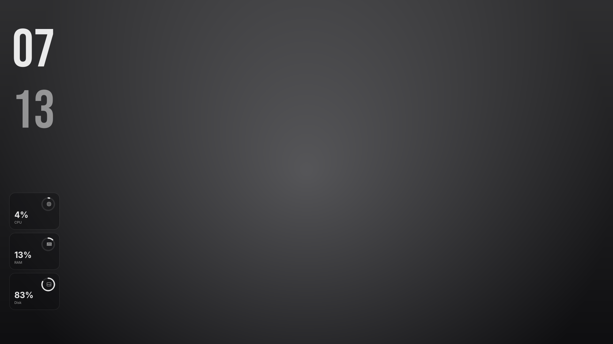
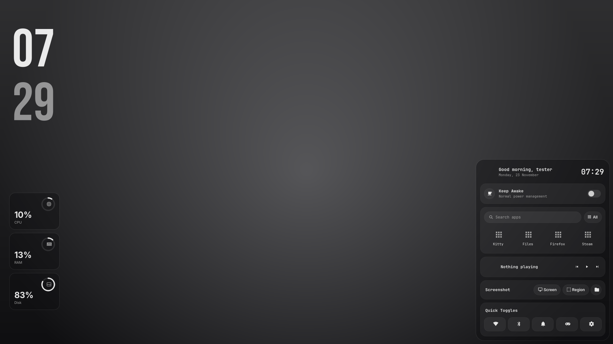
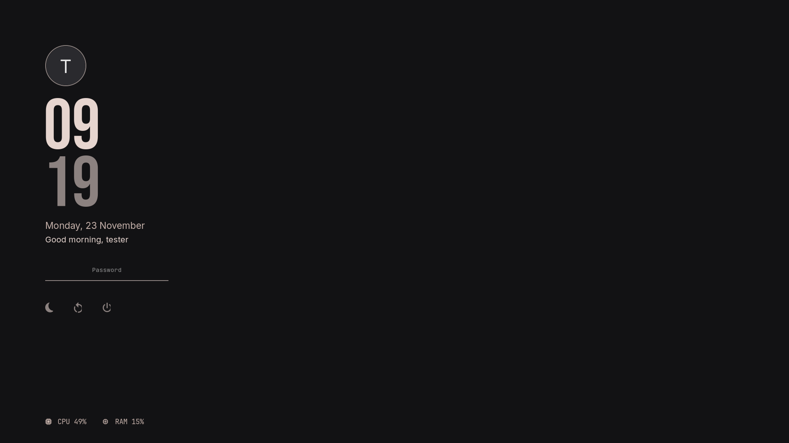

# hypr-shell

Eigenes Hyprland-Setup im Glas-Look, angelehnt an „DarkShadow's Shell“:
halbtransparente Flächen über unscharfem Hintergrund, stark gerundete Ecken und
Farben, die automatisch aus dem Hintergrundbild entstehen. Gedacht für Arch-basierte
Systeme (CachyOS) mit Hyprland ab 0.55 (Lua-Konfiguration) und Quickshell.


## Installation

```bash
gh repo clone Louidos/hypr-shell && cd hypr-shell && ./install.sh
```

Danach **abmelden und im Login-Manager „Hyprland“ wählen**. Das ist alles.

Der Installer

- prüft zuerst die Hyprland-Version: Ist ein Hyprland älter als 0.55 installiert, bricht er
  ab, bevor er etwas verändert, mit dem Hinweis `sudo pacman -Syu hyprland`,
- bietet an, vorher das System zu aktualisieren (`sudo pacman -Syu`; mit `--yes` ohne Frage),
- installiert die nötigen Pakete (pacman, den Rest mit paru) und prüft die Namen vorher,
- kopiert die Dateien nach `~/.config`, `~/.local/bin`, `~/.local/share` und `~/Pictures/Wallpapers`,
- sichert **jede** ersetzte Datei vorher nach `~/.config/hypr-shell-backup-<Zeit>/`,
- legt `~/.config/hypr-shell/settings.json` an (nur wenn sie fehlt) und trägt dort das
  Tastaturlayout aus `localectl` ein, übernimmt Umgebungsvariablen der alten
  Hyprland-Konfiguration (z. B. für NVIDIA), damit Spiele wie vorher starten,
- läuft nie als root; sudo wird nur für pacman verwendet,
- listet am Ende auf, falls noch ein Programm fehlt, und sagt, was als Nächstes zu tun ist
  (abmelden, Hyprland wählen, Wetter-Ort eintragen) und wie man alles zurücknimmt.

| Option | Wirkung |
| --- | --- |
| `--yes` | keine Rückfrage |
| `--dry-run` | nur anzeigen, was passieren würde – nichts wird verändert |
| `--no-packages` | keine Pakete installieren, nur Dateien kopieren |
| `--update` | neuen Stand holen (`git pull --ff-only`) und neu installieren; `settings.json`, `user.lua` und `hypr-shell-local.lua` bleiben unberührt |
| `--restore [ORDNER]` | Stand vor der letzten Installation zurückholen |
| `--uninstall` | alles von hypr-shell entfernen, Zustand vor der ersten Installation zurück |

## Aktualisieren

```bash
./install.sh --update
```

holt den neuen Stand aus GitHub und installiert ihn. Eigene Einstellungen
(`~/.config/hypr-shell/settings.json`, `~/.config/hypr/user.lua`,
`~/.config/hypr/hypr-shell-local.lua`) bleiben, wie sie sind. Hat man im Ordner selbst etwas
geändert, bricht `--update` ab, ohne etwas zu installieren.

## Rückgängig machen

```bash
./install.sh --restore
```

holt die Dateien zurück, die die letzte Installation ersetzt hat, und entfernt die neu
hinzugekommenen. Mit `./install.sh --restore ~/.config/hypr-shell-backup-<Zeit>` lässt sich
eine bestimmte Sicherung wählen.

```bash
./install.sh --uninstall
```

entfernt alle Dateien von hypr-shell und stellt den Zustand vor der ersten Installation
her. Die Sicherungsordner bleiben liegen. Danach abmelden und wieder anmelden.

## Tastenkürzel

| Kürzel | Wirkung |
| --- | --- |
| `SUPER + Q` | Terminal (kitty) |
| `SUPER + C` | Fenster schliessen |
| `SUPER + E` | Dateien (Nautilus) |
| `SUPER + R` / `ALT + Space` | Starter (rofi) |
| `SUPER + V` | Fenster schwebend / gekachelt |
| `SUPER + M` | abmelden (Hyprland beenden) |
| `SUPER + L` | sperren |
| `SUPER + left` / `SUPER + right` / `SUPER + up` / `SUPER + down` | Fokus in diese Richtung |
| `SUPER + 1` … `SUPER + 0` | zu Arbeitsfläche 1–10 |
| `SUPER + SHIFT + 1` … `SUPER + SHIFT + 0` | Fenster auf Arbeitsfläche 1–10 verschieben |
| `SUPER + mouse_down` / `SUPER + mouse_up` (Mausrad) | nächste / vorige Arbeitsfläche |
| `SUPER + mouse:272` (linke Maustaste ziehen) | Fenster verschieben |
| `SUPER + mouse:273` (rechte Maustaste ziehen) | Fenstergrösse ändern |
| `SUPER + ALT + D` | Dashboard öffnen / schliessen |
| `SUPER + W` | Dashboard im Tab Wallpaper |
| `SUPER + A` | Hot-Corner-Panel öffnen / schliessen |
| `SUPER + U` | Einstellungs-App öffnen / schliessen |
| `Print` | Screenshot eines Bereichs (speichern + Zwischenablage) |
| `SHIFT + Print` | Screenshot des ganzen Bildschirms (speichern + Zwischenablage) |
| `XF86AudioRaiseVolume` / `XF86AudioLowerVolume` | Lautstärke + / − |
| `XF86AudioMute` / `XF86AudioMicMute` | Ton / Mikrofon stumm |
| `XF86MonBrightnessUp` / `XF86MonBrightnessDown` | Helligkeit + / − |
| `XF86AudioPlay` / `XF86AudioPause` / `XF86AudioNext` / `XF86AudioPrev` | Medien: Play/Pause, weiter, zurück |
| `Esc` | Dashboard, Panel oder Einstellungs-App schliessen |
| Wischen mit drei Fingern | Arbeitsfläche wechseln |

Alle Kürzel lassen sich in der Einstellungs-App auf der Seite **Keybinds** ändern (Klick, dann die
neue Kombination drücken) oder mit `shell-set keybinds.<aktion> "SUPER + T"`; ein leeres Kürzel heisst
„keine Taste“. Eigene Kürzel stehen in `keybinds.custom`. Eine Kombination, die schon belegt ist, wird
abgelehnt und die belegende Aktion genannt. `SUPER + U` (Einstellungs-App) lässt sich nicht leeren.
Die Medien-, Lautstärke- und Helligkeitstasten bleiben fest.

Maus: Ecke **unten rechts** öffnet das Panel, die **Mitte der unteren Kante** das Dashboard.

## Was ist dabei?

### Leiste

Oben eine flache, halbtransparente Waybar: links Distro-Symbol (öffnet den Starter),
Arbeitsflächen 1–4 und das aktuelle Lied; rechts Lautstärke, Akku (nur mit Akku), Uhr, Bluetooth, WLAN, ein
roter Punkt während einer Bildschirmaufnahme und der Ausschalt-Knopf (sperren, abmelden,
neu starten, herunterfahren).

### Desktop

Hinter den Fenstern eine grosse gestapelte Uhr (JetBrainsMono, Stunden kräftig, Minuten
blasser) und drei Glas-Kacheln mit Ringen für CPU, Arbeitsspeicher und Grafikkarte. Schläft
die NVIDIA-Karte (Hybrid-Grafik), zeigt die GPU-Kachel „–“ – sie wird dafür nicht geweckt.



### Dashboard

Gleitet unten in der Mitte hoch. Oben vier gleich breite Tabs (Symbol über dem Text, der
aktive als weisse Pille):

| Tab | Inhalt |
| --- | --- |
| Dashboard | Wetter, Profil mit Begrüssung, Musik, Uhr, Kalender, drei Ringe für CPU/RAM/Disk |
| Wallpaper | alle Bilder aus `~/Pictures/Wallpapers` mit Suche; Klick setzt Bild und Farben |
| Performance | CPU und GPU mit Modell, Temperatur und Auslastung („Usage“; eine schlafende NVIDIA-Karte wird nicht geweckt), Datenträger, Netzwerk mit Verlauf, Arbeitsspeicher |
| About | System, Distribution, Version von hypr-shell, Hyprland und Quickshell |

Systemwerte werden nur abgefragt, solange das Dashboard offen ist.

### Hot-Corner-Panel

Wächst aus der Ecke unten rechts: Begrüssung mit Uhrzeit, **Keep Awake** (kein Sperren,
kein Standby), **Apps** mit Suche, **Now playing**, **Screenshot** (Screen, Region,
Ordner; gespeichert und in der Zwischenablage) und **Quick Toggles** für WLAN, Bluetooth, Nicht stören, Gaming-Modus (Blur,
Animationen und Schatten aus) und Einstellungen (öffnet die Einstellungs-App).



### Sperrbildschirm

Bildschirm unscharf und abgedunkelt, links Profilbild über der grossen Uhr, Datum,
Begrüssung, Passwort als Linie und Knöpfe für Standby, Neustart und Herunterfahren; unten
links CPU- und RAM-Auslastung. hypridle sperrt
nach 5 Minuten und geht nach 15 Minuten in den Standby (vorher wird gesperrt); die Zeiten stehen
in `lock.after`, `lock.screen_off` und `lock.suspend`.



### Farben und Hintergrundbild

Eigene Bilder nach `~/Pictures/Wallpapers` legen und im Dashboard (SUPER + W) anklicken
oder `shell-wallpaper <bild>` aufrufen. matugen erzeugt daraus die Farben für Hyprland,
Waybar, kitty, rofi, swaync, hyprlock und Quickshell; bei einem grauen Bild bleibt alles
grau/weiss. Mitgeliefert ist ein schlichtes graues Verlaufsbild.


Ein Profilbild wird aus `~/.face` gelesen (quadratisches Bild, z. B. PNG). Fehlt es, steht
im Dashboard, im Panel und auf dem Sperrbildschirm der Anfangsbuchstabe des Benutzers in
einem Kreis (für den Sperrbildschirm erzeugt der Installer dafür ein Ersatzbild).
App-Symbole kommen aus Papirus-Dark, dann aus hicolor, dann aus dem Pfad in der
`.desktop`-Datei; erst wenn nichts davon passt, erscheint ein Platzhalter.

## Anpassen

Alles Einstellbare steht in **einer** Datei: `~/.config/hypr-shell/settings.json` (Vorlage:
[`settings/settings.example.json`](settings/settings.example.json), Beschreibung jedes Werts:
[`settings/schema.json`](settings/schema.json)). Änderungen wirken sofort, ohne Abmelden:
Quickshell bemerkt die Änderung und ruft `shell-apply` auf. Das prüft jeden Wert, erzeugt die
Dateien für Hyprland, Waybar, hypridle, hyprlock und rofi (oben steht jeweils „erzeugt von
hypr-shell – nicht von Hand ändern“) und lädt nur den betroffenen Teil neu. Von Hand geht das mit
`shell-apply`.

- **Falscher Wert** (z. B. `"height": "abc"`, Zahl ausserhalb des Bereichs, unbekannter Name): der
  Standardwert gilt, eine Benachrichtigung nennt Schlüssel und Grund. `shell-apply --check` zeigt
  alle Probleme.
- **Kaputtes JSON** (z. B. ein fehlendes Komma): der letzte gültige Stand bleibt aktiv, eine
  Benachrichtigung nennt die Zeile.
- Fehlt ein Wert, gilt sein Standard. Eine `settings.json` aus Version 1.0 oder 1.1 funktioniert
  unverändert; Werte aus der alten `~/.config/hypr/hypr-shell-local.lua` (Tastatur, Skalierung,
  Touchpad) wandern beim ersten Start einmalig in `settings.json`.

### Mit der Einstellungs-App

`SUPER + U` (oder das Zahnrad im Panel) öffnet ein Glas-Fenster in der Bildschirmmitte. Links stehen
die Seiten Home, Bar, Look, Theme, Desktop, Dashboard, Panel, Lock & Idle, Input, Monitors, Apps,
Keybinds und About; rechts jeder Wert mit Erklärung und dem passenden Bedienelement (Schalter,
Regler mit Zahl, Auswahl, Textfeld, Farbwähler, sortierbare Liste). Jede Änderung wirkt sofort – ein
Regler schon beim Ziehen. Neben einem geänderten Wert steht **Reset**, oben auf jeder Seite
**Reset page**, ganz oben **Undo** und **Redo**. Die Suche findet Werte über Titel, Erklärung und
Schlüssel (z. B. „blur“, „clock“, „battery“) und springt zur Zeile. Auf **Home** lassen sich
Profile speichern und laden und die Einstellungen in eine Datei sichern oder daraus laden. Auf
**Monitors** stehen die echten Bildschirme aus Hyprland; eine neue Auflösung muss innerhalb von
15 Sekunden bestätigt werden, sonst gilt wieder die alte. `Esc` schliesst die App.


Weitere Seiten: [Home](docs/screenshots/settings-home.png), [Bar](docs/screenshots/settings-bar.png),
[Theme](docs/screenshots/settings-theme.png), [Monitors](docs/screenshots/settings-monitors.png),
[Suche](docs/screenshots/settings-suche.png).


### Mit dem Befehl `shell-set`

```bash
shell-set look.rounding 20
```

ändert die Fenster-Rundung sofort; `shell-set undo` nimmt es zurück. Ein falscher Wert
(`shell-set look.rounding abc`) wird abgelehnt, die Meldung nennt den erlaubten Bereich, und nichts
ändert sich.

| Befehl | Wirkung |
| --- | --- |
| `shell-set list [bereich]` | alle Werte (oder z. B. nur `look`) mit aktuellem Wert, Standard und Erklärung; `*` = geändert |
| `shell-set get <schlüssel>` | aktueller Wert |
| `shell-set <schlüssel> <wert>` | setzen; Listen als `a,b,c` oder JSON, Schalter als `true`/`false` oder `on`/`off` |
| `shell-set reset <schlüssel\|bereich\|all>` | auf den Standard zurück |
| `shell-set undo` / `shell-set redo` | letzte Änderung zurücknehmen / wiederholen (die letzten 20 Schritte) |
| `shell-set profile save\|load\|list\|delete <name>` | Profile in `~/.config/hypr-shell/profiles/` |
| `shell-set export <datei>` / `shell-set import <datei>` | sichern / laden (ein Import wird vorher geprüft) |

Die Tab-Taste vervollständigt in bash und fish Befehle, Schlüssel und erlaubte Werte.

| Wert | Standard | Bedeutung |
| --- | --- | --- |
| `bar.position` | `"top"` | Edge of the screen the bar sits on – erlaubt: `top`, `bottom` |
| `bar.height` | `30` | Height of the bar in pixels (20–60 px) |
| `bar.opacity` | `0.25` | Opacity of the bar background (0–1) |
| `bar.modules.left` | `["distro", "workspaces", "media"]` | Modules on the left, in this order – erlaubt: `distro`, `workspaces`, `window`, `media`, `volume`, `battery`, `clock`, `bluetooth`, `network`, `tray`, `recording`, `power` |
| `bar.modules.center` | `[]` | Modules in the middle, in this order – erlaubt: `distro`, `workspaces`, `window`, `media`, `volume`, `battery`, `clock`, `bluetooth`, `network`, `tray`, `recording`, `power` |
| `bar.modules.right` | `["volume", "battery", "clock", "bluetooth", "network", "recording", "power"]` | Modules on the right, in this order – erlaubt: `distro`, `workspaces`, `window`, `media`, `volume`, `battery`, `clock`, `bluetooth`, `network`, `tray`, `recording`, `power` |
| `bar.workspaces` | `4` | Workspaces that are always shown (0 = only used ones) (0–10) |
| `bar.clock` | `"24h"` | 24-hour or 12-hour clock in the bar – erlaubt: `24h`, `12h` |
| `bar.battery` | `true` | Show the battery (only on devices with a battery) |
| `look.gaps.inner` | `6` | Space between windows (0–40 px) |
| `look.gaps.outer` | `12` | Space between windows and the screen edge (0–60 px) |
| `look.border` | `1` | Width of the window border (0–8 px) |
| `look.rounding` | `12` | Corner radius of windows (0–30 px) |
| `look.blur.enabled` | `true` | Blur behind transparent windows, the bar and the glass panels |
| `look.blur.size` | `10` | Radius of the blur (1–20) |
| `look.blur.passes` | `3` | More passes give a softer blur but cost more (1–6) |
| `look.shadow` | `true` | Soft shadow under windows |
| `look.opacity.inactive` | `1.0` | Opacity of windows without focus (0.5–1) |
| `look.animations.enabled` | `true` | Animate windows, workspaces and layers |
| `look.animations.speed` | `"normal"` | How fast animations play – erlaubt: `slow`, `normal`, `fast` |
| `theme.colors` | `"auto"` | auto = colors from the wallpaper, grey = grey and white, custom = your accent color – erlaubt: `auto`, `grey`, `custom` |
| `theme.accent` | `"#8ab4f8"` | Accent color for the custom color mode |
| `theme.glass` | `0.44` | Opacity of the desktop tiles and the settings window (0.1–0.95) |
| `theme.radius.panel` | `26` | Corner radius of glass panels (0–40 px) |
| `theme.radius.card` | `18` | Corner radius of cards inside panels (0–30 px) |
| `theme.font.ui` | `"Inter"` | Font for text in the bar, dashboard, panel and lock screen |
| `theme.font.mono` | `"JetBrainsMono Nerd Font"` | Font for symbols and numbers (needs Nerd Font symbols) |
| `theme.font.clock` | `"JetBrainsMono Nerd Font"` | Font of the big clock on the desktop |
| `theme.font.display` | `"Bebas Neue"` | Font of the clocks in the dashboard and on the lock screen |
| `theme.font.scale` | `1.0` | Factor for all font sizes (0.8–1.5) |
| `theme.cursor.name` | `"Bibata-Modern-Ice"` | Name of the mouse cursor theme |
| `theme.cursor.size` | `24` | Size of the mouse cursor (16–64 px) |
| `theme.icons` | `"Papirus-Dark"` | Icon theme for apps in the panel and the launcher |
| `input.layout` | `"us"` | Layout code like us, de or ch |
| `input.variant` | `""` | Variant like de or fr for ch (empty = standard) |
| `input.sensitivity` | `0` | -1 = slow, 0 = normal, 1 = fast (-1–1) |
| `input.touchpad.natural_scroll` | `false` | Touchpad content follows your fingers |
| `input.touchpad.tap_to_click` | `true` | Tapping the touchpad clicks |
| `monitors.scale` | `"auto"` | Scale for screens without their own entry: auto or a number like 1.25, 1.5, 2 |
| `monitors.outputs` | `[]` | Settings for single screens; empty values mean automatic |
| `desktop.screen` | `""` | Screen for widgets, dashboard and panel (name from hyprctl monitors, empty = first) |
| `desktop.clock.enabled` | `true` | Big stacked clock on the desktop |
| `desktop.clock.format` | `"24h"` | 24-hour or 12-hour clock – erlaubt: `24h`, `12h` |
| `desktop.clock.x` | `0.02` | Distance from the left as a share of the screen width (0–1) |
| `desktop.clock.y` | `0.045` | Distance from the top as a share of the screen height (0–1) |
| `desktop.clock.scale` | `1.0` | Size factor of the clock (0.3–3) |
| `desktop.resources.enabled` | `true` | Usage tiles on the desktop |
| `desktop.resources.tiles` | `["cpu", "ram", "gpu"]` | Tiles and their order – erlaubt: `cpu`, `ram`, `gpu`, `disk` |
| `desktop.resources.x` | `0.015` | Distance from the left as a share of the screen width (0–1) |
| `desktop.resources.y` | `0.56` | Distance from the top as a share of the screen height (0–1) |
| `desktop.resources.scale` | `1.0` | Size factor of the tiles (0.3–3) |
| `dashboard.width` | `1000` | Width of the dashboard in pixels (600–2400 px) |
| `dashboard.opacity` | `0.42` | Opacity of the glass (0.1–0.95) |
| `dashboard.edge` | `true` | Open when the mouse touches the middle of the bottom edge |
| `dashboard.close_on_leave` | `true` | Close when the mouse leaves the dashboard |
| `dashboard.tabs` | `["dashboard", "wallpaper", "performance", "about"]` | Tabs and their order – erlaubt: `dashboard`, `wallpaper`, `performance`, `about` |
| `dashboard.start` | `"dashboard"` | Tab shown when the dashboard opens – erlaubt: `dashboard`, `wallpaper`, `performance`, `about` |
| `dashboard.cards` | `["weather", "profile", "media", "clock", "calendar", "rings"]` | Cards on the Dashboard tab – erlaubt: `weather`, `profile`, `media`, `clock`, `calendar`, `rings` |
| `weather.location` | `""` | Place for the weather, e.g. Zürich |
| `weather.units` | `"metric"` | metric = °C, imperial = °F – erlaubt: `metric`, `imperial` |
| `panel.enabled` | `true` | Open the panel when the mouse touches the corner |
| `panel.corner` | `"bottom-right"` | Screen corner of the panel – erlaubt: `bottom-right`, `bottom-left`, `top-right`, `top-left` |
| `panel.trigger` | `6` | Size of the corner area in pixels (1–40 px) |
| `panel.close_on_leave` | `true` | Close when the mouse leaves the panel |
| `panel.close_delay` | `400` | Wait time before closing after the mouse left (100–10000 ms) |
| `panel.width` | `420` | Width of the panel (320–800 px) |
| `panel.radius` | `26` | Corner radius of the panel (0–40 px) |
| `panel.opacity` | `0.44` | Opacity of the glass (0.1–0.95) |
| `panel.sections` | `["awake", "apps", "media", "shot", "toggles"]` | Cards and their order – erlaubt: `awake`, `apps`, `media`, `shot`, `toggles` |
| `panel.apps` | `["kitty", "org.gnome.Nautilus", "firefox", "spotify", "discord", "steam"]` | Apps in the grid (name of the .desktop file); missing ones are skipped |
| `panel.toggles` | `["wifi", "bluetooth", "dnd", "gaming", "settings"]` | Quick toggles and their order – erlaubt: `wifi`, `bluetooth`, `dnd`, `gaming`, `awake`, `settings` |
| `lock.after` | `5` | Lock the screen after this many idle minutes (0 = never) (0–120 min) |
| `lock.screen_off` | `0` | Turn the screen off after this many idle minutes (0 = never) (0–120 min) |
| `lock.suspend` | `15` | Go to standby after this many idle minutes (0 = never) (0–240 min) |
| `lock.blur` | `3` | Blur passes of the lock screen background (0 = none) (0–6) |
| `lock.dim` | `0.5` | How much darker the background gets (0–0.9) |
| `lock.avatar` | `true` | Show ~/.face (or your initial) above the clock |
| `lock.clock` | `"24h"` | 24-hour or 12-hour clock – erlaubt: `24h`, `12h` |
| `apps.terminal` | `"kitty"` | Command for the terminal |
| `apps.files` | `"nautilus"` | Command for the file manager |
| `apps.browser` | `"firefox"` | Command for the web browser |
| `apps.launcher` | `"rofi -show drun"` | Command for the app launcher |
| `keybinds.terminal` | `"SUPER + Q"` | Open the terminal (apps.terminal) |
| `keybinds.files` | `"SUPER + E"` | Open the file manager (apps.files) |
| `keybinds.browser` | `""` | Open the browser (apps.browser); empty = no key |
| `keybinds.launcher` | `"SUPER + R"` | Open the app launcher (apps.launcher) |
| `keybinds.launcher_alt` | `"ALT + Space"` | Another key for the app launcher |
| `keybinds.close` | `"SUPER + C"` | Close the focused window |
| `keybinds.float` | `"SUPER + V"` | Switch the focused window between floating and tiled |
| `keybinds.focus_left` | `"SUPER + left"` | Move the focus to the window on the left |
| `keybinds.focus_right` | `"SUPER + right"` | Move the focus to the window on the right |
| `keybinds.focus_up` | `"SUPER + up"` | Move the focus to the window above |
| `keybinds.focus_down` | `"SUPER + down"` | Move the focus to the window below |
| `keybinds.workspace_mod` | `"SUPER"` | Modifier for 1 … 0 (go to workspace) and the mouse wheel; empty = off |
| `keybinds.move_mod` | `"SUPER + SHIFT"` | Modifier for 1 … 0 (move the window there); empty = off |
| `keybinds.mouse_mod` | `"SUPER"` | Modifier for dragging (left button) and resizing (right button) windows; empty = off |
| `keybinds.dashboard` | `"SUPER + ALT + D"` | Open or close the dashboard |
| `keybinds.wallpaper` | `"SUPER + W"` | Open the dashboard on the Wallpaper tab |
| `keybinds.panel` | `"SUPER + A"` | Open or close the hot corner panel |
| `keybinds.settings` | `"SUPER + U"` | Open or close this settings app (cannot be empty) |
| `keybinds.lock` | `"SUPER + L"` | Lock the screen |
| `keybinds.exit` | `"SUPER + M"` | Leave Hyprland |
| `keybinds.screenshot_region` | `"Print"` | Select a region; saved and copied |
| `keybinds.screenshot_screen` | `"SHIFT + Print"` | Whole screen; saved and copied |
| `keybinds.custom` | `[]` | Own key combinations that run a command |

Ein Beispiel – Leiste unten und etwas höher, grössere Abstände, nach 10 Minuten sperren:

```json
{
  "bar": { "position": "bottom", "height": 36 },
  "look": { "gaps": { "inner": 10, "outer": 20 } },
  "lock": { "after": 10 }
}
```

Eigene Hyprland-Zeilen (Fensterregeln, weitere Tastenkürzel) gehören nach
`~/.config/hypr/user.lua` – diese Datei überschreibt der Installer nie, und sie gilt zuletzt.

## Laptop

Für Laptops sind vor allem diese Werte gedacht: `monitors.scale` (Skalierung, `"auto"` oder eine
Zahl wie `"1.5"`), `input.touchpad.natural_scroll` und `input.touchpad.tap_to_click`. Ein Bildschirm
lässt sich auch einzeln einstellen:

```json
{
  "monitors": {
    "scale": "auto",
    "outputs": [ { "name": "eDP-1", "resolution": "2560x1600", "refresh": 165, "scale": "1.6" } ]
  },
  "input": { "touchpad": { "natural_scroll": true } }
}
```

XWayland-Programme wie Steam, Battle.net oder GOG-Spiele werden bei einer Skalierung über 1
nicht hochgerechnet (`xwayland.force_zero_scaling`): Sie bleiben scharf, erscheinen dafür in
ihrer eigenen Grösse. Ein Akku erscheint in der Leiste rechts vor der Uhr (Symbol und Prozent,
unter 15 % in Warnfarbe, beim Laden mit Blitz) – nur, wenn der Rechner einen Akku hat
(abschalten mit `bar.battery`).

## Hilfsprogramme

| Befehl | Wirkung |
| --- | --- |
| `shell-set …` | Einstellungen lesen, ändern, zurücksetzen, rückgängig machen, Profile (siehe „Anpassen“) |
| `shell-apply` | Einstellungen prüfen und anwenden (`--check` nur prüfen) |
| `shell-wallpaper <bild>` | Hintergrundbild setzen und Farben erzeugen (Farbmodus aus `theme.colors`) |
| `shell-screenshot region\|screen\|folder` | Screenshot bzw. Ordner öffnen |
| `shell-toggle <wifi\|bluetooth\|dnd\|gaming\|awake> [on\|off]` | Schnellschalter, `shell-toggle status` zeigt alle |
| `shell-quickshell restart` | Oberfläche neu starten |
| `shell-powermenu` | Ausschalt-Menü |

## Aufbau

| Ordner | Inhalt |
| --- | --- |
| `config/` | Dotfiles, die nach `~/.config` kopiert werden |
| `quickshell/` | QML-Oberfläche: `desktop/`, `dashboard/`, `panel/`, `settings/` (Einstellungs-App), `common/` |
| `bin/` | Hilfsskripte für `~/.local/bin` |
| `wallpapers/` | mitgelieferte Hintergrundbilder |
| `settings/` | `schema.json` (Beschreibung aller Werte) und `settings.example.json` (Standardwerte) |
| `tests/` | Prüfskripte (`tests/lint.sh`, `tests/probeinstallation.sh`, …) |
| `docs/` | Doku und Screenshots |

Die Screenshots stammen aus dem Oberflächentest der CI (unsichtbarer Compositor,
Software-Rendering): Sie zeigen Aufbau und Masse, aber **ohne Blur**. Ohne Grafikkarte
haben Profilbild, Cover und Vorschaubilder dort eckige statt runde Ecken.

## Projektstand

Version: **1.1.0** (siehe [`VERSION`](VERSION)). Änderungen stehen in [CHANGELOG.md](CHANGELOG.md).
Was nur auf dem echten Rechner geprüft werden kann, steht in [docs/abnahme.md](docs/abnahme.md).
Optik und Aufbau sind an „DarkShadow's Shell“ (MIT) angelehnt; der Code ist neu geschrieben,
übernommene Masse und Formen sind in [NOTICE](NOTICE) vermerkt.
Die mitgelieferte Schrift Bebas Neue steht unter der SIL Open Font License
(`quickshell/common/fonts/OFL.txt`).
