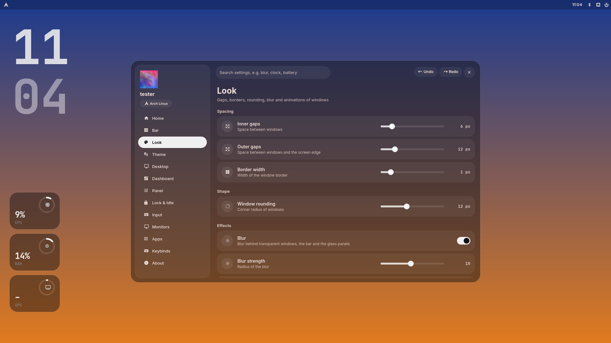

# hypr-shell

Eigenes Hyprland-Setup im Glas-Look, angelehnt an „DarkShadow's Shell“:
halbtransparente Flächen über unscharfem Hintergrund, stark gerundete Ecken und
Farben, die automatisch aus dem Hintergrundbild entstehen. Gedacht für Arch-basierte
Systeme (CachyOS) mit Hyprland ab 0.55 (Lua-Konfiguration) und Quickshell.


## Installation

```bash
gh repo clone Louidos/hypr-shell && cd hypr-shell && ./install.sh
```

Danach **abmelden und im Login-Manager „Hyprland“ wählen**. Das ist alles.

Der Installer

- prüft zuerst die Hyprland-Version: Ist ein Hyprland älter als 0.55 installiert, bricht er
  ab, bevor er etwas verändert, mit dem Hinweis `sudo pacman -Syu hyprland`,
- bietet an, vorher das System zu aktualisieren (`sudo pacman -Syu`; mit `--yes` ohne Frage),
- installiert die nötigen Pakete (pacman, den Rest mit paru) und prüft die Namen vorher,
- kopiert die Dateien nach `~/.config`, `~/.local/bin`, `~/.local/share` und `~/Pictures/Wallpapers`,
- sichert **jede** ersetzte Datei vorher nach `~/.config/hypr-shell-backup-<Zeit>/`,
- legt `~/.config/hypr-shell/settings.json` an (nur wenn sie fehlt) und trägt dort das
  Tastaturlayout aus `localectl` ein, übernimmt Umgebungsvariablen der alten
  Hyprland-Konfiguration (z. B. für NVIDIA), damit Spiele wie vorher starten,
- läuft nie als root; sudo wird nur für pacman verwendet,
- listet am Ende auf, falls noch ein Programm fehlt, und sagt, was als Nächstes zu tun ist
  (abmelden, Hyprland wählen, Wetter-Ort eintragen) und wie man alles zurücknimmt.

| Option | Wirkung |
| --- | --- |
| `--yes` | keine Rückfrage |
| `--dry-run` | nur anzeigen, was passieren würde – nichts wird verändert |
| `--no-packages` | keine Pakete installieren, nur Dateien kopieren |
| `--update` | neuen Stand holen (`git pull --ff-only`) und neu installieren; `settings.json`, `user.lua` und `hypr-shell-local.lua` bleiben unberührt |
| `--restore [ORDNER]` | Stand vor der letzten Installation zurückholen |
| `--uninstall` | alles von hypr-shell entfernen, Zustand vor der ersten Installation zurück |

## Aktualisieren

```bash
./install.sh --update
```

holt den neuen Stand aus GitHub und installiert ihn. Eigene Einstellungen
(`~/.config/hypr-shell/settings.json`, `~/.config/hypr/user.lua`,
`~/.config/hypr/hypr-shell-local.lua`) bleiben, wie sie sind. Hat man im Ordner selbst etwas
geändert, bricht `--update` ab, ohne etwas zu installieren.

## Rückgängig machen

```bash
./install.sh --restore
```

holt die Dateien zurück, die die letzte Installation ersetzt hat, und entfernt die neu
hinzugekommenen. Mit `./install.sh --restore ~/.config/hypr-shell-backup-<Zeit>` lässt sich
eine bestimmte Sicherung wählen.

```bash
./install.sh --uninstall
```

entfernt alle Dateien von hypr-shell und stellt den Zustand vor der ersten Installation
her. Die Sicherungsordner bleiben liegen. Danach abmelden und wieder anmelden.

## Tastenkürzel

`SUPER + F1` zeigt alle Kürzel als Spickzettel – in Gruppen, mit Suche, gelesen aus den echten
Belegungen (`hyprctl binds -j`), also immer auf dem aktuellen Stand. Eigene Kürzel stehen dort unter
„Custom“.

| Kürzel | Wirkung |
| --- | --- |
| `SUPER + Q` | Terminal (kitty) |
| `SUPER + C` | Fenster schliessen |
| `SUPER + E` | Dateien (Nautilus) |
| `SUPER + R` / `SUPER + Space` / `ALT + Space` | Starter (Suche nach Apps, `=` rechnet) |
| `SUPER + V` | Fenster schwebend / gekachelt |
| `SUPER + SHIFT + V` | Verlauf der Zwischenablage |
| `SUPER + Tab` | Fenster-Übersicht aller Arbeitsflächen |
| `SUPER + F1` | Kürzel-Spickzettel |
| `SUPER + M` | abmelden (Hyprland beenden) |
| `SUPER + L` | sperren |
| `SUPER + Escape` | Power-Menü (Lock, Sleep, Logout, Restart, Shutdown) |
| `SUPER + left` / `SUPER + right` / `SUPER + up` / `SUPER + down` | Fokus in diese Richtung |
| `SUPER + 1` … `SUPER + 0` | zu Arbeitsfläche 1–10 |
| `SUPER + SHIFT + 1` … `SUPER + SHIFT + 0` | Fenster auf Arbeitsfläche 1–10 verschieben |
| `SUPER + mouse_down` / `SUPER + mouse_up` (Mausrad) | nächste / vorige Arbeitsfläche |
| `SUPER + mouse:272` (linke Maustaste ziehen) | Fenster verschieben |
| `SUPER + mouse:273` (rechte Maustaste ziehen) | Fenstergrösse ändern |
| `SUPER + ALT + D` / `SUPER + D` | Dashboard öffnen / schliessen |
| `SUPER + W` | Dashboard im Tab Wallpaper |
| `SUPER + A` | Hot-Corner-Panel öffnen / schliessen |
| `SUPER + N` | Benachrichtigungen (Verlauf) öffnen / schliessen |
| `SUPER + U` | Einstellungs-App öffnen / schliessen |
| `SUPER + ALT + W` | Uhr und Kacheln auf dem Desktop verschieben und skalieren |
| `Print` | Screenshot eines Bereichs (speichern + Zwischenablage) |
| `SHIFT + Print` | Screenshot des ganzen Bildschirms (speichern + Zwischenablage) |
| `XF86AudioRaiseVolume` / `XF86AudioLowerVolume` | Lautstärke + / − |
| `XF86AudioMute` / `XF86AudioMicMute` | Ton / Mikrofon stumm |
| `XF86MonBrightnessUp` / `XF86MonBrightnessDown` | Helligkeit + / − |
| `XF86KbdBrightnessUp` / `XF86KbdBrightnessDown` | Tastaturbeleuchtung + / − |
| `XF86AudioPlay` / `XF86AudioPause` / `XF86AudioNext` / `XF86AudioPrev` | Medien: Play/Pause, weiter, zurück |
| `Esc` | Dashboard, Panel oder Einstellungs-App schliessen (auch ein Klick daneben schliesst) |
| Wischen mit drei Fingern | Arbeitsfläche wechseln |

Alle Kürzel lassen sich in der Einstellungs-App auf der Seite **Keybinds** ändern (Klick, dann die
neue Kombination drücken) oder mit `shell-set keybinds.<aktion> "SUPER + T"`; ein leeres Kürzel heisst
„keine Taste“. Eigene Kürzel stehen in `keybinds.custom`. Eine Kombination, die schon belegt ist, wird
abgelehnt und die belegende Aktion genannt. `SUPER + U` (Einstellungs-App) lässt sich nicht leeren.
Die Medien-, Lautstärke- und Helligkeitstasten bleiben fest.

Maus: Ecke **unten rechts** öffnet das Panel, die **Mitte der unteren Kante** das Dashboard.
Es ist immer nur ein Panel offen: Öffnet man eines, schliesst das andere. Jedes Panel lässt sich
auch per `shell-quickshell ipc <name> toggle` öffnen und schliessen (`dashboard`, `panel`, `settings`).

## Was ist dabei?

### Leiste

Oben eine flache, halbtransparente Waybar: links Distro-Symbol (öffnet den Starter),
Arbeitsflächen 1–4 und das aktuelle Lied; rechts Lautstärke, Akku (nur mit Akku), Uhr, Bluetooth, WLAN, ein
roter Punkt während einer Bildschirmaufnahme, die Glocke mit der Zahl der Benachrichtigungen und der Ausschalt-Knopf (sperren, abmelden,
neu starten, herunterfahren).

### Desktop

Hinter den Fenstern eine grosse gestapelte Uhr (JetBrainsMono, Stunden kräftig, Minuten
blasser) und drei Glas-Kacheln mit Ringen für CPU, Arbeitsspeicher und Grafikkarte. Schläft
die NVIDIA-Karte (Hybrid-Grafik), zeigt die GPU-Kachel „–“ – sie wird dafür nicht geweckt.

**Verschieben:** `SUPER + ALT + W` (oder „Edit on desktop“ auf der Seite Desktop der
Einstellungs-App) schaltet in den Bearbeiten-Modus: Uhr und Kacheln bekommen einen Rahmen, lassen sich
mit der Maus ziehen und mit dem Mausrad grösser oder kleiner machen; an den Rändern und der Mitte
rasten sie an Hilfslinien ein. Oben stehen **Done** (speichern), **Cancel** und **Reset positions**;
`Esc` bricht ab. Gespeichert wird die Lage als Anteil der Bildschirmgrösse (`desktop.clock.x` …), die
Grösse als Faktor (`desktop.clock.scale`). Ausserhalb des Modus nehmen die Widgets keine Klicks an.


### Dashboard

Gleitet unten in der Mitte hoch. Oben gleich breite Tabs (Symbol über dem Text, der
aktive als weisse Pille):

| Tab | Inhalt |
| --- | --- |
| Dashboard | Wetter, Profil mit Begrüssung, Musik, Uhr, Kalender, drei Ringe für CPU/RAM/Disk |
| Wallpaper | alle Bilder aus `~/Pictures/Wallpapers` mit Suche; Klick setzt Bild und Farben |
| Performance | CPU und GPU mit Modell, Temperatur und Auslastung („Usage“; eine schlafende NVIDIA-Karte wird nicht geweckt), Datenträger, Netzwerk mit Verlauf, Arbeitsspeicher |
| Games | zuletzt gespielte Steam-Spiele mit Cover, Klick startet; eigene Einträge (GOG, Battle.net …) mit `games.custom_enabled` und `games.custom`. Ohne Spiele fehlt der Tab |
| About | System, Distribution, Version von hypr-shell, Hyprland und Quickshell |

Systemwerte werden nur abgefragt, solange das Dashboard offen ist.

**Gaming-Modus automatisch:** Läuft ein Spiel im Vollbild (Steam-Spiele, gamescope; weitere über
`games.auto_classes`), schaltet hypr-shell Blur, Animationen und Schatten aus und danach wieder an. Ein
von Hand eingeschalteter Gaming-Modus bleibt, wie er ist; abschalten mit `shell-set games.auto_gaming false`.

### Starter

`SUPER + R` (oder `SUPER + Space`, `ALT + Space`, das Distro-Symbol links in der Leiste) öffnet in der
Mitte ein Suchfeld im Glas-Look: Tippen sucht Apps nach Name, Beschreibung und Stichworten, zuletzt
benutzte stehen oben; Pfeiltasten wählen, Enter startet, Esc schliesst. Beginnt die Eingabe mit `=`,
wird gerechnet (`=12*8` zeigt 96, auch `^`, `%`, Klammern, `sqrt()`, `pi`); Enter kopiert das Ergebnis.
Wer lieber rofi oder einen anderen Starter will: `shell-set apps.launcher "rofi -show drun"`
(zurück mit `shell-set apps.launcher builtin`).

### Benachrichtigungen

Benachrichtigungen erscheinen oben rechts als Glas-Karten mit Symbol, Titel, Text und Knöpfen. Nach
`notifications.timeout` Sekunden (Standard 6) verschwinden sie, dringende bleiben, bis man sie schliesst.
Alle landen im Verlauf: `SUPER + N` oder ein Klick auf die Glocke in der Leiste (mit Zähler) öffnet ihn –
nach App gruppiert, einzeln, je App oder mit **Clear all** löschbar, oben der Schalter **Do not
disturb** (auch Rechtsklick auf die Glocke oder `shell-toggle dnd`). Mit Nicht stören erscheinen keine
Karten, der Verlauf füllt sich trotzdem. hypr-shell ist dabei selbst der Benachrichtigungsdienst
(swaync wird nicht mehr gestartet); mit `shell-set notifications.enabled false` lässt sich ein anderer
Dienst verwenden.

### Lautstärke-Anzeige und Power-Menü

Lautstärke-, Stumm-, Mikrofon- und Helligkeitstasten (auch die Tastaturbeleuchtung) zeigen unten in der
Mitte eine kleine Glas-Pille mit Symbol und Balken, die nach 1,5 Sekunden verschwindet (`shell-osd`;
abschalten mit `shell-set osd.enabled false`). Das Power-Menü (`SUPER + Escape` oder ⏻ in der Leiste)
zeigt in der Mitte fünf grosse Knöpfe: **Lock**, **Sleep**, **Logout**, **Restart**, **Shutdown**.
Pfeiltasten wählen, Enter löst aus, Esc schliesst; Restart und Shutdown verlangen einen zweiten Druck.

### Fenster-Übersicht

`SUPER + Tab` zeigt alle Arbeitsflächen als Raster mit ihren Fenstern an der richtigen Stelle – mit
Vorschaubild, sonst App-Symbol und Titel. Klick wechselt zum Fenster, Ziehen auf eine andere
Arbeitsfläche verschiebt es dorthin, Tippen filtert nach Titel (Enter springt zum ersten Treffer).

### Zwischenablage

`SUPER + SHIFT + V` zeigt die letzten Kopien (Text und Bilder, aufgezeichnet mit cliphist ab der
Anmeldung): Suchfeld oben, Bilder mit Vorschau. Pfeiltasten wählen, **Enter** fügt den Eintrag im
vorigen Fenster ein, **Entf** löscht ihn, **Clear all** leert den Verlauf. Wie viele Einträge bleiben,
steht in `clipboard.max` (Standard 50); `shell-set clipboard.enabled false` schaltet die Aufzeichnung ab.

### Hot-Corner-Panel

Wächst aus der Ecke unten rechts: Begrüssung mit Uhrzeit, **Keep Awake** (kein Sperren,
kein Standby), **Apps** mit Suche, **Now playing**, **Screenshot** (Screen, Region,
Ordner; gespeichert und in der Zwischenablage) und **Quick Toggles**: WLAN, Bluetooth, Ton (stumm),
Nicht stören, Gaming-Modus (Blur, Animationen und Schatten aus), **Leistungsprofil** (ein Klick
schaltet weiter: Power saver → Balanced → Performance), **Nachtlicht** (hyprsunset, Wärme in
`nightlight.temperature`, Zeitplan mit `nightlight.schedule`, `nightlight.from`, `nightlight.to`) und
Einstellungen (öffnet die Einstellungs-App). Schalter, die der Rechner nicht hat (kein WLAN, kein
Bluetooth-Adapter, kein hyprsunset …), fehlen einfach.

WLAN, Bluetooth und Ton haben einen kleinen Pfeil (oder Rechtsklick): er öffnet im Panel eine
**Unterseite** mit Zurück-Pfeil – WLAN: Netze mit Stärke, verbinden (mit Passwortfeld), trennen;
Bluetooth: gekoppelte und neue Geräte mit Akkustand, suchen, koppeln, verbinden; Ton: Ausgabe- und
Eingabegerät wählen (wirkt sofort) und Lautstärke je App. Ein Klick auf das WLAN-, Bluetooth- oder
Ton-Symbol in der Leiste öffnet direkt die passende Unterseite (Rechtsklick auf den Ton: stumm).


### Sperrbildschirm

Bildschirm unscharf und abgedunkelt, links Profilbild über der grossen Uhr, Datum,
Begrüssung, Passwort als Linie und Knöpfe für Standby, Neustart und Herunterfahren; unten
links CPU- und RAM-Auslastung. hypridle sperrt
nach 5 Minuten und geht nach 15 Minuten in den Standby (vorher wird gesperrt); die Zeiten stehen
in `lock.after`, `lock.screen_off` und `lock.suspend`.


### Farben und Hintergrundbild

Eigene Bilder nach `~/Pictures/Wallpapers` legen und im Dashboard (SUPER + W) anklicken
oder `shell-wallpaper <bild>` aufrufen. matugen erzeugt daraus die Farben für Hyprland,
Waybar, kitty, rofi, hyprlock und Quickshell; bei einem grauen Bild bleibt alles
grau/weiss. Mitgeliefert ist ein schlichtes graues Verlaufsbild.


Ein Profilbild wird aus `~/.face` gelesen (quadratisches Bild, z. B. PNG). Fehlt es, steht
im Dashboard, im Panel und auf dem Sperrbildschirm der Anfangsbuchstabe des Benutzers in
einem Kreis (für den Sperrbildschirm erzeugt der Installer dafür ein Ersatzbild).
App-Symbole kommen aus Papirus-Dark, dann aus hicolor, dann aus dem Pfad in der
`.desktop`-Datei; erst wenn nichts davon passt, erscheint ein Platzhalter.

## Anpassen

Alles Einstellbare steht in **einer** Datei: `~/.config/hypr-shell/settings.json`. Drei Wege führen
dorthin – alle schreiben in dieselbe Datei, und jede Änderung wirkt sofort, ohne Abmelden:

1. **Einstellungs-App** – `SUPER + U` (oder das Zahnrad im Panel): Schalter, Regler, Listen, Suche,
   Reset und Undo, dazu Profile und Export/Import.
2. **Befehl** – `shell-set look.rounding 20` ändert einen Wert, `shell-set undo` nimmt ihn zurück,
   `shell-set list` zeigt alle Werte mit Standard und Erklärung.
3. **Datei** – `settings.json` im Editor öffnen; fehlende Werte haben ihren Standard. Ein falscher
   Wert wird gemeldet und durch den Standard ersetzt, bei kaputtem JSON bleibt der letzte gültige
   Stand aktiv.



**Jeder Wert** mit Standard, erlaubten Werten, Erklärung und `shell-set`-Beispiel steht in
[docs/einstellungen.md](docs/einstellungen.md) (aus [`settings/schema.json`](settings/schema.json)
erzeugt). Eigene Hyprland-Zeilen (Fensterregeln usw.) gehören nach `~/.config/hypr/user.lua` – diese
Datei überschreibt der Installer nie, und sie gilt zuletzt.

### Mit der Einstellungs-App

Links stehen die Seiten Home, Bar, Look, Theme, Desktop, Dashboard, Panel, System, Laptop (nur auf Laptops mit asusctl, supergfxctl oder power-profiles-daemon), Lock & Idle, Input,
Monitors, Apps, Keybinds und About; rechts jeder Wert mit Erklärung und dem passenden Bedienelement.
Ein Regler wirkt schon beim Ziehen. Neben einem geänderten Wert steht **Reset**, oben auf jeder Seite
**Reset page**, ganz oben **Undo** und **Redo**; die Suche findet Werte über Titel, Erklärung und
Schlüssel (z. B. „blur“, „clock“, „battery“) und springt zur Zeile. Auf **Monitors** stehen die echten
Bildschirme aus Hyprland; eine neue Auflösung muss innerhalb von 15 Sekunden bestätigt werden, sonst
gilt wieder die alte. **About** öffnet `settings.json` und diese Übersicht. Weitere Seiten:
[Home](docs/screenshots/settings-home.png), [Bar](docs/screenshots/settings-bar.png),
[Theme](docs/screenshots/settings-theme.png), [Monitors](docs/screenshots/settings-monitors.png),
[Keybinds](docs/screenshots/settings-keybinds.png), [Suche](docs/screenshots/settings-suche.png).

### Mit dem Befehl `shell-set`

| Befehl | Wirkung |
| --- | --- |
| `shell-set list [bereich]` | alle Werte (oder z. B. nur `look`) mit aktuellem Wert, Standard und Erklärung; `*` = geändert |
| `shell-set get <schlüssel>` | aktueller Wert |
| `shell-set <schlüssel> <wert>` | setzen; Listen als `a,b,c` oder JSON, Schalter als `true`/`false` oder `on`/`off`; ein falscher Wert nennt den erlaubten Bereich und ändert nichts |
| `shell-set set <s1> <w1> <s2> <w2> …` | mehrere Werte in einem Schritt |
| `shell-set reset <schlüssel\|bereich\|all>` | auf den Standard zurück |
| `shell-set undo` / `shell-set redo` | letzte Änderung zurücknehmen / wiederholen (die letzten 20 Schritte) |
| `shell-set profile save\|load\|list\|delete <name>` | Profile in `~/.config/hypr-shell/profiles/` |
| `shell-set export <datei>` / `shell-set import <datei>` | sichern / laden (ein Import wird vorher geprüft) |

Die Tab-Taste vervollständigt in bash und fish Befehle, Schlüssel und erlaubte Werte. Werte aus der
alten `~/.config/hypr/hypr-shell-local.lua` (Version 1.1) wandern beim ersten Start einmalig in
`settings.json`; eine `settings.json` aus Version 1.0 oder 1.1 funktioniert unverändert.

## Laptop

Auf ASUS-ROG-Laptops (z. B. Zephyrus M16) steuert hypr-shell über `asusctl` und `supergfxctl`
(installiert der Installer nicht selbst, er schlägt sie nur vor):

- **Leistungsprofil** – Schalter im Panel (Quiet → Balanced → Performance, über asusctl; ohne
  asusctl über power-profiles-daemon) und auf der Seite **Laptop** der Einstellungs-App.
- **Grafik-Modus** – Seite Laptop: Integrated, Hybrid, AsusMuxDgpu … mit Bestätigung, danach ab- oder
  neu anmelden.
- **Ladegrenze** – `laptop.charge_limit` (z. B. 80 %); asusd behält sie über Neustarts, hypr-shell setzt
  sie beim Anmelden noch einmal.
- **Tastaturlicht** – `laptop.kbd_light` (off/low/med/high) und `laptop.kbd_follow_wallpaper` (Farbe folgt
  dem Hintergrundbild).

Die Seite Laptop und jede Zeile darauf erscheinen nur, wenn der Rechner die Funktion hat; ohne
asusctl taucht nichts davon auf. Befehl: `shell-laptop status`.

Für Laptops sind vor allem diese Werte gedacht: `monitors.scale` (Skalierung, `"auto"` oder eine
Zahl wie `"1.5"`), `input.touchpad.natural_scroll` und `input.touchpad.tap_to_click`. Ein Bildschirm
lässt sich auch einzeln einstellen:

```json
{
  "monitors": {
    "scale": "auto",
    "outputs": [ { "name": "eDP-1", "resolution": "2560x1600", "refresh": 165, "scale": "1.6" } ]
  },
  "input": { "touchpad": { "natural_scroll": true } }
}
```

XWayland-Programme wie Steam, Battle.net oder GOG-Spiele werden bei einer Skalierung über 1
nicht hochgerechnet (`xwayland.force_zero_scaling`): Sie bleiben scharf, erscheinen dafür in
ihrer eigenen Grösse. Ein Akku erscheint in der Leiste rechts vor der Uhr (Symbol und Prozent,
unter 15 % in Warnfarbe, beim Laden mit Blitz) – nur, wenn der Rechner einen Akku hat
(abschalten mit `bar.battery`).

## Hilfsprogramme

| Befehl | Wirkung |
| --- | --- |
| `shell-set …` | Einstellungen lesen, ändern, zurücksetzen, rückgängig machen, Profile (siehe „Anpassen“) |
| `shell-apply` | Einstellungen prüfen und anwenden (`--check` nur prüfen) |
| `shell-wallpaper <bild>` | Hintergrundbild setzen und Farben erzeugen (Farbmodus aus `theme.colors`) |
| `shell-screenshot region\|screen\|folder` | Screenshot bzw. Ordner öffnen |
| `shell-toggle <wifi\|bluetooth\|audio\|dnd\|gaming\|awake\|nightlight> [on\|off]` | Schnellschalter, `shell-toggle profile` schaltet das Leistungsprofil weiter, `shell-toggle status` zeigt alle |
| `shell-games list\|launch <id>` | Spiele für den Tab Games |
| `shell-laptop status\|profile\|gfx\|charge\|kbd …` | Laptop-Funktionen (asusctl, supergfxctl, power-profiles-daemon) |
| `shell-net wifi\|bt …` | WLAN und Bluetooth für die Unterseiten im Panel |
| `shell-quickshell restart` | Oberfläche neu starten |
| `shell-powermenu [aktion]` | Power-Menü bzw. direkt `lock`, `suspend`, `logout`, `reboot`, `shutdown` |
| `shell-clipboard list\|paste\|delete\|clear …` | Verlauf der Zwischenablage |
| `shell-osd volume\|mic\|brightness\|kbd …` | Lautstärke/Helligkeit ändern und anzeigen |

## Aufbau

| Ordner | Inhalt |
| --- | --- |
| `config/` | Dotfiles, die nach `~/.config` kopiert werden |
| `quickshell/` | QML-Oberfläche: `desktop/`, `dashboard/`, `panel/`, `settings/` (Einstellungs-App), `common/` |
| `bin/` | Hilfsskripte für `~/.local/bin` |
| `wallpapers/` | mitgelieferte Hintergrundbilder |
| `settings/` | `schema.json` (Beschreibung aller Werte) und `settings.example.json` (Standardwerte) |
| `tests/` | Prüfskripte (`tests/lint.sh`, `tests/probeinstallation.sh`, …) |
| `docs/` | Doku: [einstellungen.md](docs/einstellungen.md) (alle Werte, aus dem Schema erzeugt), [abnahme.md](docs/abnahme.md), Screenshots |

Die Screenshots stammen aus dem Oberflächentest der CI (unsichtbarer Compositor,
Software-Rendering): Sie zeigen Aufbau und Masse, aber **ohne Blur**. Ohne Grafikkarte
haben Profilbild, Cover und Vorschaubilder dort eckige statt runde Ecken.

## Projektstand

Version: **1.3.0** (siehe [`VERSION`](VERSION)). Änderungen stehen in [CHANGELOG.md](CHANGELOG.md).
Was nur auf dem echten Rechner geprüft werden kann, steht in [docs/abnahme.md](docs/abnahme.md).
Optik und Aufbau sind an „DarkShadow's Shell“ (MIT) angelehnt; der Code ist neu geschrieben,
übernommene Masse und Formen sind in [NOTICE](NOTICE) vermerkt.
Die mitgelieferte Schrift Bebas Neue steht unter der SIL Open Font License
(`quickshell/common/fonts/OFL.txt`).
